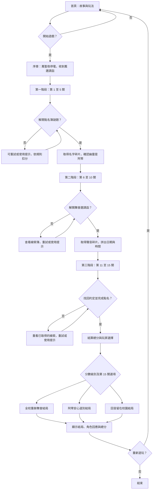
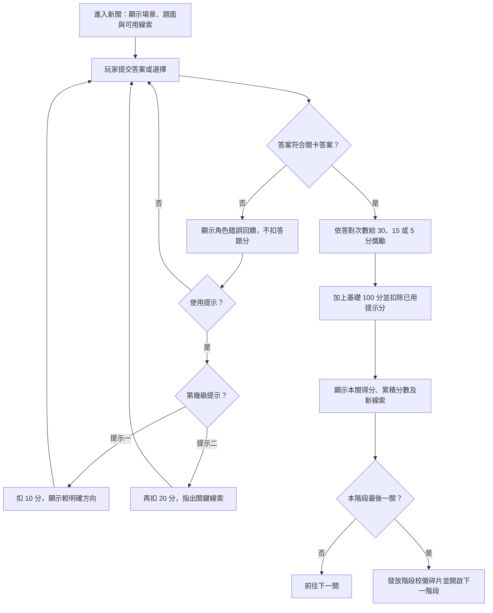
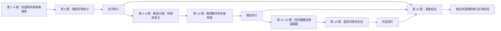

# 完整遊戲企劃：《午夜鐘聲，南瓜學院》

## 文件目的與摘要

本文件定義遊戲的玩家體驗、核心玩法、關卡內容、操作規則、技術與素材限制，以及本次不製作的功能，作為後續設計與製作共同依據。遊戲定位為單人、瀏覽器遊玩的校園萬聖節解謎冒險；本輪交付是企劃文件，不代表遊戲程式或素材已完成。

**一句話介紹**：萬聖節夜，轉學生林小滿被困在南瓜學院，必須在午夜鐘樓再次敲響前，和怪奇社找回三枚校徽碎片，解開幽靈學生阿零等待了三十年的舞會約定。

## 玩法核心

玩家在校園場景閱讀劇情、觀察物件和角色留下的資料，解一道有明確規則的謎題；答對後取得新線索，線索推進故事並打開下一關。遊戲的核心樂趣來自「看見線索 → 推理答案 → 發現故事真相」，而不是快速操作或懲罰玩家。

### 玩家循環

1. **進入場景**：讀取地點、當下劇情與角色對話。
2. **觀察線索**：查看文字、圖案、數字、聲音描述、地圖或線索簿。
3. **選擇解題方式**：輸入答案、選擇選項或按順序排列資料；每關會明確說明操作。
4. **取得回應**：答錯可重試；回饋引導玩家重新觀察。玩家可選擇使用提示。
5. **解鎖內容**：答對後顯示劇情變化、關卡分數及新線索。
6. **推進主線**：每五關取得一枚校徽碎片，三枚碎片在最終點名時匯合。
7. **做出結尾選擇**：第 15 關選擇阿零的去留；總分影響可看到的回憶細節和結局版本。

### 設計原則

- 每題的正解須能從題面或先前取得的線索推出；不靠猜作者心意。
- 答錯不扣答題分、不倒退關卡、不丟失已取得的線索。
- 提示是玩家可自行選用的協助，代價是減少本關得分；不使用提示仍可通關。
- 角色對話同時服務於個性、解題協助或故事，不只裝飾畫面。
- 恐怖氛圍以神秘、奇幻和溫暖為主，不使用血腥、驚嚇音量或突然閃屏。

## 故事與角色

玩家林小滿在萬聖夜停電後被困南瓜學院，和怪奇社成員找回「名字、聲音、約定」三枚校徽碎片。阿零是三十年前的學生；暴雨與停電使他未能赴萬聖舞會，從此被困在未完成的約定裡。他害怕大家忘記那段回憶，因此造成校園異象，但不是要傷害玩家的反派。玩家逐漸理解他的動機，最後決定邀全校重辦舞會、陪他安心道別，或請他留下作為學院守護者。

| 角色 | 身分與個性 | 在遊戲中的功能 |
|---|---|---|
| 林小滿 | 轉學生，擅長觀察 | 玩家角色；檢查物件、整理線索並選擇結局 |
| 周小葵 | 學生會長，冷靜細心 | 提醒規則、協助排除錯誤推理 |
| 阿栗 | 南瓜燈精靈，嘴硬心軟 | 照亮暗處、辨認顏色與圖案 |
| 阿零 | 幽靈學生，記憶模糊 | 主線核心；記憶隨碎片逐步恢復 |
| 蝠仔 | 蝙蝠，愛收集聲音 | 重播節奏、辨認錄音順序 |
| 墨水 | 黑貓圖書員 | 提供書目、分類和資料查找線索 |
| 鐵齒 | 掃地機器人 | 協助操作機關與齒輪 |
| 霧子 | 霧精靈，怕強光 | 顯示玻璃上的字與隱藏線索 |
| 烏鴉教官 | 鐘樓管理員 | 說明鐘樓規則、見證最後選擇 |

## 遊戲結構

- **單人遊戲**：玩家扮演林小滿，不設多人同時操作。
- **三階段、共 15 關**：每階段五關；第 5、10、15 關分別收束階段故事。
- **建議遊玩時間**：約 20–35 分鐘，屬企劃估計，實際需由試玩確認。
- **主要場景**：玄關、教室、走廊、圖書館、化學教室、社團教室、廣播室、舊禮堂、天台與鐘樓。
- **關卡解鎖**：依序完成，不可跳關；已解鎖關卡可回看線索，但重玩不重複得分。

## 共通玩法與計分

每關答題；錯誤可重試且不扣答題分。答題次數以本關第一次提交為第一試。答對後取得基礎分與一次答題獎勵：第一次答對加 30、第二次加 15、第三次起加 5。每關提示最多兩級：提示一扣 10 分，提示二再扣 20 分。提示可在作答前後使用，扣分於本關結算時扣除，單關得分最低為 0；每關只結算一次，重玩不重複領分。

| 情況 | 計分例 |
|---|---:|
| 不用提示，第一次答對 | 100 + 30 = 130 |
| 用提示一，第一次答對 | 100 + 30 − 10 = 120 |
| 用兩級提示，第三次答對 | 100 + 5 − 10 − 20 = 75 |
| 全部 15 關第一次答對且不用提示 | 15 × 130 = 1,950 |

總分結尾級別：1,400 分以上為高分、1,200–1,399 為中分、1,199 以下為低分。分數決定回憶細節與角色追加對話；玩家在第 15 關的選擇決定阿零去留。不得出現分數門檻重疊、缺漏或選擇後無法通關的情況。

## 操作方式

### 桌面操作

- 滑鼠：點擊場景可互動物件、提示、線索簿、選項及送出按鈕。
- 鍵盤：Tab 移動焦點、Enter/空白鍵啟動按鈕；文字答案可用 Enter 送出。
- 方向選擇、排序題、文字輸入題都要同時提供可見操作說明；不要求玩家猜隱藏手勢。

### 手機與平板操作

- 以直向畫面為主，內容可上下捲動；互動按鈕須有文字標籤和足夠點擊區。
- 不依賴滑鼠懸停才出現的線索；所有可互動物件均可點按。
- 橫向或窄螢幕不可遮住答案欄、提示按鈕或送出按鈕。

### 畫面與資訊回饋

- **首頁**：標題、故事摘要、開始遊戲、玩法與計分說明。
- **關卡畫面**：階段/關卡名稱、場景、角色劇情、可互動線索、答案區、提示按鈕、目前分數。
- **線索簿**：保存已取得線索，標記來源關卡，供玩家回看。
- **答題結果**：錯誤時顯示角色提示；正確時顯示分數變化、劇情變化和新線索。
- **階段收束**：顯示校徽碎片、階段總結、累積分數及下一階段入口。
- **結局畫面**：顯示玩家選擇、總分、結局內容、角色回應及重新開始。

## 技術限制

- 成品預定為靜態網頁，使用原生 HTML、CSS、JavaScript。
- 不使用 React、Vue、Angular 等框架，不需要伺服器端程式、資料庫或帳號系統。
- 不依賴建置工具、套件安裝或外部 API；解壓後可用瀏覽器開啟。若實作需本機伺服器，必須在交付說明寫明啟動方式與原因。
- 關卡資料、提示、答案、劇情分支集中管理，避免同一規則散落在多處而難以修改。
- 遊戲狀態至少包含目前關卡、總分、每關作答次數、使用提示次數、已得線索和最後選擇。
- 本版進度只要求在目前瀏覽器工作階段中有效；跨裝置同步及永久帳號存檔不在範圍內。若重新整理會失去進度，畫面須明確告知；若採瀏覽器本機儲存，需提供重置進度操作。
- 不載入遠端字型、追蹤碼、廣告或外部影像服務。

## 素材限制

- 優先使用 CSS 圖形、文字、簡單幾何圖案或專案內自製 SVG；不要求寫實插圖。
- 若使用圖片、音效或字型，必須放在專案資料夾，並記錄來源、授權和檔案用途；不直接連結未確認授權的網路素材。
- 謎題不能只靠顏色辨識；顏色線索同時加上文字、符號或形狀，例如紅色藥瓶另標「紅」字與圓形符號。
- 聲音謎題須提供文字節奏或視覺替代，避免沒有聲音設備的玩家卡關。
- 動畫保持短而不閃爍；重要資訊不能只透過動畫或音效傳達。
- 不使用血腥畫面、驚嚇跳出畫面、突然大音量或快速閃光。

## 本次不做的事

- 不做多人連線、聊天室、玩家配對或排行榜。
- 不做帳號登入、雲端存檔、跨裝置同步、付費或廣告。
- 不做隨機生成關卡、每日任務、成就系統、道具商店或複雜背包。
- 不做自由移動的 3D 校園、即時戰鬥、倒數死亡、生命值或強制限時。
- 不做語音辨識、麥克風錄音、攝影機或位置權限功能。
- 不做需要網路查資料、外部 API 或安裝外掛才能解的謎題。
- 不把課堂提交期限、GitHub/Discord 團隊協作規則放進遊戲劇情或玩家畫面。
- 不把本文件視為已完成的可執行遊戲；程式、美術和試玩驗收須另行完成。
## 第一階段：消失的點名簿

### 1. 玄關的南瓜燈
**場景/題面**：三盞燈標 A、B、C；牆上記著「A 朝鐘樓（北），B 朝月亮（西），C 朝校門（南）」。每盞可選北東南西。**答案**：北、西、南。**提示**：逐字依照三個標記。**錯誤回應**：影子仍交錯，阿栗說先看燈上的字母。**答對**：牆上亮出座位表，得線索「缺席座位在 5 號置物櫃」。

### 2. 會換座位的教室
**題面**：座位表四列：第一列 1、2、3；第二列 4、空、6；第三列 7、8、9。規則寫「空位號碼等於左邊加右邊，再除以二」。**答案**：5 號置物櫃。**提示**：看空格左右的 4 和 6。**錯誤回應**：置物櫃不動；小葵提醒先算平均。**答對**：取得 5 號櫃紙條「日期鏡像寫著 0131」。

### 3. 黑板上的倒數題
**題面**：鏡中日期 0131，黑板註明「左右倒讀，不倒轉數字形狀」。**答案**：四位數 1310（文字數字倒序）。**提示**：將字串最後一位先讀。**錯誤回應**：鎖沒有反應；霧子說只換順序，不做數學運算。**答對**：開啟 1310 號抽屜，找到節奏圖「短、長、短」。

### 4. 走廊的腳步聲
**題面**：門牌依序是「短、長、短」三種敲擊圖示；錄音片段標出三聲節奏，請選門牌順序。**答案**：短—長—短。**提示**：照錄音播放次序，不按長短排序。**錯誤回應**：門後只傳回回音；蝠仔重播第一聲。**答對**：取得點名簿缺頁，寫著「阿零」。

### 5. 失名的點名簿
**題面**：缺頁列出候選姓名阿零、阿栗、周小葵；前關找到的紙條寫「兩字，名字有『零』，幽靈學生」。**答案**：阿零。**提示**：結合字數、字和身分三條線索。**錯誤回應**：墨水散開；小葵提醒三條條件要同時符合。**答對**：取得「名字」碎片；阿零想起舞會邀請。

## 第二階段：被鎖住的萬聖舞會

### 6. 圖書館的移動書架
**題面**：四本書依索書號 1–4 排列，書背字依次為「舊、禮、堂、頂」。**答案**：舊禮堂頂樓。**提示**：按號碼讀字。**錯誤回應**：書架滑回原位；墨水提示先找索書號。**答對**：找到化學實驗紀錄。

### 7. 化學教室的彩色泡泡
**題面**：紀錄寫紅+藍=紫、黃+藍=綠；桌上三瓶依標籤「黃、藍、紅」，鎖要輸入每瓶混藍後的顏色。**答案**：綠、藍、紫（藍與藍仍藍）。**提示**：逐瓶套用紀錄。**錯誤回應**：泡泡熄掉；阿栗說不要調換瓶子順序。**答對**：紫光顯出日期 10/31。

### 8. 鏡中社團教室
**題面**：海報上的日期在鏡中顯示為「13/01」。桌上對照卡寫明：「鏡中內容左右反讀，斜線位置不變。」海報鏡中日期為「13/01」。**答案**：10/31（將字串左右倒序，斜線仍放在中間）。**提示**：把斜線左右的字元分別倒過來讀。**錯誤回應**：鏡面日期仍模糊；霧子提醒先反排。**答對**：確認舞會日期 10/31。

### 9. 廣播室的失真留言
**題面**：三段錄音標記 1、2、3，內容「我在舊禮堂」「十點半等你」「帶上邀請函」。**答案**：依 1→2→3 排序，還原留言。**提示**：看錄音編號。**錯誤回應**：聲音倒放；蝠仔提醒聽開頭報號。**答對**：知道阿零約在 10:30。

### 10. 舞會門口的邀請函
**題面**：候選舞伴阿零/阿栗；候選時間 10:00/10:30。線索：幽靈學生、廣播留言。**答案**：阿零、10:30。**提示**：把第 5 關姓名和第 9 關時間合併。**錯誤回應**：門鈴短響一次；墨水說兩個欄位都要填。**答對**：取得「聲音」碎片，門後響起未完成的舞曲。

## 第三階段：鐘樓十三響

### 11. 天台的星形風向標
**題面**：地圖北在上；鐘樓在學校西北角。風向標指西，規則「入口在鐘樓朝風的一側」。**答案**：鐘樓西側。**提示**：先找鐘樓，再看風向。**錯誤回應**：牆面無縫；烏鴉教官提示地圖方向。**答對**：找到樓梯機房。

### 12. 齒輪樓梯
**題面**：三齒輪齒數 2、3、6，需以最小齒輪帶動中輪、中輪帶動大輪；問大輪轉一圈時小輪轉幾圈。**答案**：3 圈（轉速與齒數成反比，6/2）。**提示**：大齒輪慢，小齒輪快。**錯誤回應**：樓梯只升半層；鐵齒提示比較首尾齒數。**答對**：樓梯升至鐘面。

### 13. 鐘樓的十三個刻痕
**題面**：鐘面每格 5 分鐘；紙條寫 10:30，從 12 點方向順時針數。**答案**：第 7 格（30 分鐘=6格；標 12 點為第 1 刻，目標在 6 格之後）。**提示**：10:30 的分針指向 6。**錯誤回應**：鐘聲少一響；阿零說起點是 12。**答對**：找到刻字「答應一起跳最後一支舞」。

### 14. 阿零的記憶教室
**題面**：三張回憶卡：A「拿走校徽」、B「約好舞會」、C「把邀請函藏起來」；日記寫「不是偷走，也不是藏起來，我在等朋友」。**答案**：B。**提示**：排除日記明確否認的兩項。**錯誤回應**：回憶模糊；小葵請逐句排除。**答對**：取得「約定」碎片並解鎖最後點名。

### 15. 最後一次點名
**題面**：選擇「邀全校重辦舞會」「送阿零安心離開」「請阿零留下」。依序顯示三碎片及分數結局。**答案**：無唯一答案；三選一即通關。**提示**：閱讀阿零真正願望，再選你認為公平的安排。**錯誤回應**：無錯誤選項；選後可返回確認一次。**結局**：選重辦且分數≥1,400：全校共舞；選送別且分數≥1,200：安心道別；低分或選留下：回音仍在校園，阿栗承諾陪伴。其餘組合顯示相應選擇與分數的混合結尾。

## 畫面、操作與未定事項
首頁、遊戲場景、線索簿、關卡完成頁、結局頁；滑鼠與鍵盤可操作，手機窄螢幕直向閱讀。預定純 HTML/CSS/JavaScript。尚未製作程式或美術。第 8 關依題面明示的左右反讀規則解碼；實作時需把對照卡文字直接呈現，避免依賴字型外觀。

## 故事與遊戲流程圖

### 玩家遊戲主流程

### 關卡內解題與積分流程

### 三階段線索流向

## 開場與結尾文字方向

- **開場**：萬聖節晚上，南瓜學院突然停電。林小滿在玄關撿到一封寫著「10 月 31 日，十點半，舊禮堂見」的舊邀請函；鐘樓卻在午夜前先敲了十三下。
- **真相揭露**：阿零是三十年前的學生。他與朋友約好在舞會跳最後一支舞，暴雨停電讓舞會取消；多年來沒有人再提起這個約定，他的記憶因而困在校徽碎片裡。
- **結尾選擇**：重辦舞會代表全校共同記住這段回憶；安心道別代表承認約定並陪阿零完成最後一支舞；邀阿零留下則讓他成為學院故事守護者。分數決定角色能否補齊更多回憶細節，選項決定阿零的去留。

